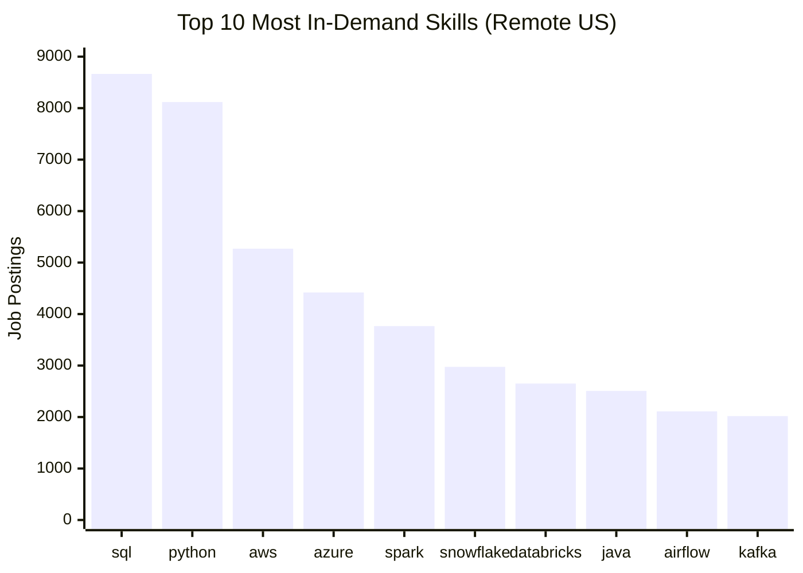
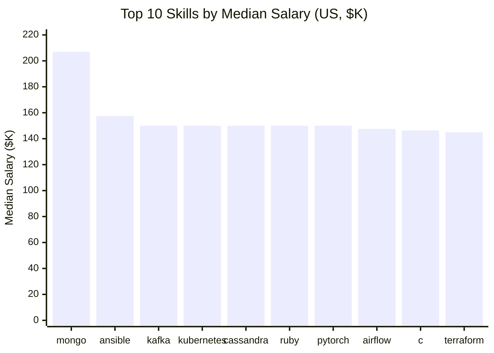
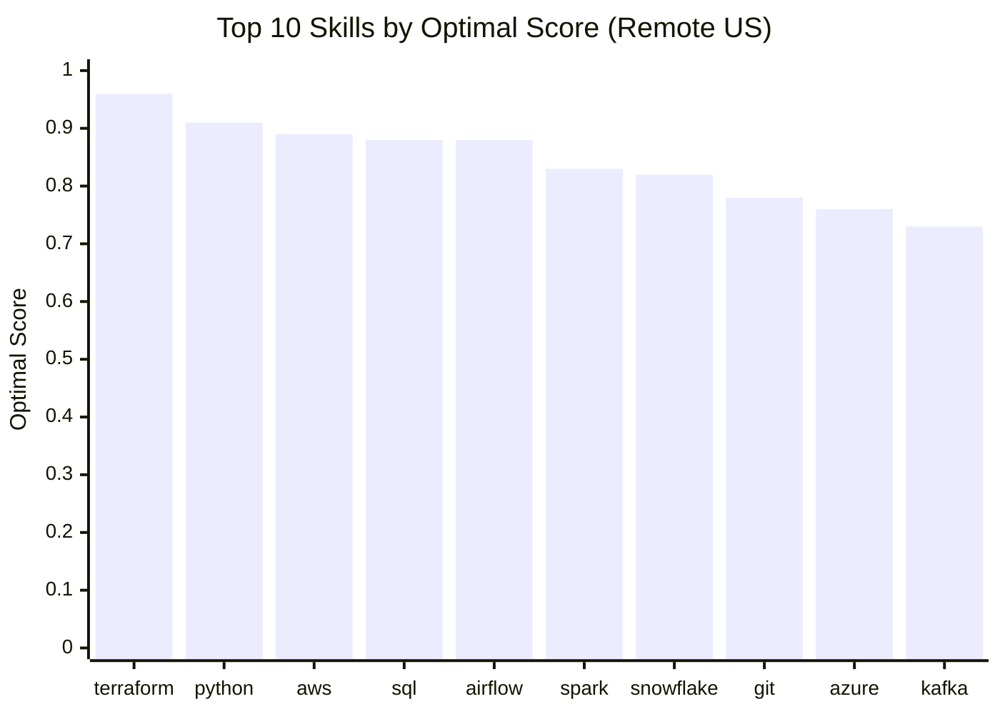

<a id="top"></a>

<p align="center">
  
</p>

<p align="center">
  
  
  
  
  
</p>

<p align="center">
  <a href="#-executive-summary-for-hiring-managers">Summary</a> •
  <a href="#-problem--context">Context</a> •
  <a href="#-architecture">Architecture</a> •
  <a href="#-the-analysis">Analysis</a> •
  <a href="#-conclusion">Conclusion</a> •
  <a href="#-sql-skills-demonstrated">SQL Skills</a>
</p>

---

## 📌 Project Overview

A SQL project analysing the **data engineer job market** using real-world job posting data. It turns one practical business question into data-driven answers:

> **Which skills should a data engineer learn to be the most employable and best paid?**

The analysis is split into three focused queries: the most **in-demand** skills, the **highest-paying** skills, and the **optimal** skills that balance both.

---

## 🧾 Executive Summary (For Hiring Managers)

| | |
|---|---|
| ✅ **Project scope** | Built 3 analytical queries that answer key questions about the data engineer job market |
| ✅ **Data modelling** | Queried a star schema using multi-table joins across fact, bridge and dimension tables |
| ✅ **Analytics** | Used aggregations, robust statistics (median), log transformation and a custom scoring metric |
| ✅ **Outcomes** | Identified the core skill stack, the best-paid specialisations and the skills with the best pay-to-demand balance |

**⏱️ If you only have a minute, review these:**

| Query | What it shows |
|---|---|
| 📈 [`01_top_demanded_skills.sql`](01_top_demanded_skills.sql#L9-L22) | Demand analysis with multi-table joins |
| 💰 [`02_top_paying_skills.sql`](02_top_paying_skills.sql#L10-L28) | Salary analysis with median aggregation and `HAVING` filters |
| ⚖️ [`03_optimal_skills.sql`](03_optimal_skills.sql#L10-L30) | Combined demand/salary optimisation with a log-weighted score |

---

## 🧩 Problem & Context

Anyone planning a data engineering career, and anyone hiring for one, needs answers to three questions:

| | Question | Answered by |
|---|---|---|
| 🎯 | **Most in-demand:** Which skills do employers ask for most often? | [01_top_demanded_skills.sql](01_top_demanded_skills.sql) |
| 💰 | **Highest paid:** Which skills are associated with the highest salaries? | [02_top_paying_skills.sql](02_top_paying_skills.sql#L10-L28) |
| ⚖️ | **Best trade-off:** Which skills balance demand and compensation? | [03_optimal_skills.sql](03_optimal_skills.sql#L10-L30) |

---

## 🏗 Architecture

<p align="center">
  
</p>

| Layer | What it is |
|---|---|
| 🗄️ **Data Warehouse** | Data science job postings stored in **DuckDB** (an OLAP engine built for analytical queries), hosted on **MotherDuck** |
| 🧮 **SQL Analytics** | Three SQL scripts, each answering one business question |
| 📊 **Data Insights** | Top demanded skills, high-paying skills and optimal skills |

### Data Warehouse Schema

The warehouse uses a **star schema**: a central fact table of job postings, dimension tables for companies and skills, and a bridge table that resolves the many-to-many relationship between postings and skills.

<p align="center">
  
</p>

| Table | Type | Key Columns | Description |
|---|---|---|---|
| `job_postings_fact` | Fact | `job_id` (PK), `company_id` (FK) | One row per job posting: title, location, schedule type, remote flag, posted date, degree and health insurance mentions, country, and yearly/hourly salary |
| `skills_job_dim` | Bridge | `job_id`, `skill_id` (PK/FK) | Resolves the many-to-many relationship between postings and skills |
| `skills_dim` | Dimension | `skill_id` (PK) | Skills catalog with skill names and types |
| `company_dim` | Dimension | `company_id` (PK) | Company name, links and thumbnail |

### 🧰 Tech Stack

| | Tool | Use |
|---|---|---|
| 🐤 | **DuckDB** | Fast, columnar OLAP query engine |
| ☁️ | **MotherDuck** | Cloud-hosted DuckDB data warehouse |
| 🧮 | **SQL** | All analysis, including analytical and mathematical functions |
| 🛠️ | **VS Code + DuckDB CLI** | Writing and running queries |
| 📦 | **Git / GitHub** | Version control for SQL scripts |

### 📂 Repository Structure

```
1_EDA/
├── 01_top_demanded_skills.sql    # Demand analysis
├── 02_top_paying_skills.sql      # Salary analysis + remote vs US comparison
├── 03_optimal_skills.sql         # Combined demand/salary optimisation
└── README.md                     # You are here
```

---

## 🔬 The Analysis

### 📈 1. Top Demanded Skills

> **Question:** Which skills appear most often in remote US data engineer job postings?
>
> 📄 **Query:** [`01_top_demanded_skills.sql`](01_top_demanded_skills.sql#L9-L22)

**Approach**
- Join job postings to their skills through the `skills_job_dim` bridge table
- Filter to remote data engineer roles in the United States
- Count postings per skill and return the top 10



**Key findings**
- 🧠 **SQL (8,665)** and **Python (8,118)** are by far the most requested skills, about 1.6x the next closest.
- ☁️ **Cloud platforms** come next: AWS (5,269) and Azure (4,419).
- 🔥 **Spark (3,766)** completes the top 5, showing the importance of big data processing.
- 🧱 **Modern data platforms and pipeline tools** (Snowflake, Databricks, Airflow, Kafka) are all in strong demand.

**Why it matters:** Demand shows which skills employers expect as standard. These are the skills that open the most doors.

<p align="right"><a href="#top">⬆ back to top</a></p>

---

### 💰 2. Top Paying Skills

> **Question:** Which skills are associated with the highest salaries for data engineers in the United States?
>
> 📄 **Query:** [`02_top_paying_skills.sql`](02_top_paying_skills.sql#L10-L28)

**Approach**
- Filter to US data engineer postings that list a yearly salary
- Calculate the **median** salary per skill (robust to extreme salaries, unlike the average)
- Keep only skills that appear in at least **100 postings**, to avoid noisy results from rare skills
- Include `demand_count` so pay can be read alongside demand



**Key findings**
- 🥇 **MongoDB** has the highest median at **$207K**, but from only 203 postings, so it likely reflects a few high-paying employers or senior roles.
- 📏 Outside of MongoDB, pay is **tightly clustered**: ranks 2-25 all fall between **$137.5K and $157.5K**.
- ⚖️ **Kafka** ($150K, 1,492 postings) and **Airflow** ($147.5K, 1,159 postings) offer the best balance of pay and demand.
- 🧱 **Infrastructure / DevOps skills** pay well but appear less often: Kubernetes ($150K), Terraform ($145K), Ansible ($157.5K).
- 📊 The **most in-demand skills pay slightly less**: AWS ($137.5K, 3,292 postings), Spark ($140K, 2,544), Java ($138.1K, 1,789).

<details>
<summary><b>📋 View full results (top 25)</b></summary>

| # | Skill | Median Salary | Demand |
|---|---|---|---|
| 1 | mongo | $207,000 | 203 |
| 2 | ansible | $157,500 | 140 |
| 3 | kafka | $150,000 | 1,492 |
| 4 | kubernetes | $150,000 | 669 |
| 5 | cassandra | $150,000 | 421 |
| 6 | ruby | $150,000 | 132 |
| 7 | pytorch | $150,000 | 113 |
| 8 | airflow | $147,500 | 1,159 |
| 9 | c | $146,325 | 158 |
| 10 | terraform | $145,000 | 487 |
| 11 | elasticsearch | $141,420 | 173 |
| 12 | scala | $140,500 | 1,473 |
| 13 | jira | $140,500 | 352 |
| 14 | spark | $140,000 | 2,544 |
| 15 | hadoop | $140,000 | 1,419 |
| 16 | docker | $140,000 | 641 |
| 17 | javascript | $140,000 | 405 |
| 18 | tensorflow | $140,000 | 168 |
| 19 | pyspark | $139,000 | 657 |
| 20 | java | $138,100 | 1,789 |
| 21 | redshift | $138,100 | 1,348 |
| 22 | looker | $138,000 | 239 |
| 23 | aws | $137,500 | 3,292 |
| 24 | nosql | $137,500 | 1,211 |
| 25 | mysql | $137,500 | 664 |

</details>

<details>
<summary><b>🌍 Remote vs US comparison</b></summary>

The script also runs the same analysis for **remote** data engineer jobs:

- **Consistent pay signals:** Kubernetes ($150.5K remote vs $150K US), Airflow ($150K vs $147.5K) and Ruby ($150K in both).
- **Large swings:** Terraform ($184K remote vs $145K US) and MongoDB ($162K remote vs $207K US). Their medians depend heavily on the job mix.
- **Different skill profiles:** the remote list leans toward software-engineering skills (Rust, Golang, Spring, GraphQL, FastAPI); the US list leans toward the classic data stack (Kafka, Spark, Hadoop, Scala, Redshift, AWS).

</details>

<p align="right"><a href="#top">⬆ back to top</a></p>

---

### ⚖️ 3. Optimal Skills

> **Question:** Which skills give the best balance of **demand and salary** for remote US data engineers?
>
> 📄 **Query:** [`03_optimal_skills.sql`](03_optimal_skills.sql#L10-L30)

**Approach**
- Filter to remote US data engineer postings with a yearly salary, for skills in at least 100 postings
- Build a custom **optimal score**:

```sql
optimal_score = MEDIAN(salary_year_avg) * LN(COUNT(*)) / 1000000
```

- The **natural log** compresses demand, so very common skills don't automatically win and salary still carries real weight.



| Rank | Skill | Median Salary | Demand | Optimal Score |
|:---:|---|---:|---:|:---:|
| 🥇 | **Terraform** | $192,750 | 146 | **0.96** |
| 🥈 | **Python** | $135,500 | 853 | **0.91** |
| 🥉 | **AWS** | $140,000 | 583 | **0.89** |
| 4 | SQL | $130,000 | 850 | 0.88 |
| 5 | Airflow | $154,000 | 298 | 0.88 |
| 6 | Spark | $140,000 | 369 | 0.83 |
| 7 | Snowflake | $139,500 | 352 | 0.82 |

**Key findings**
- 🏆 **Terraform** ranks first because of its high salary, despite only 146 postings.
- 🧠 **Python, AWS, SQL, Airflow, Spark and Snowflake** form the core data engineering stack, with solid pay and the highest demand.
- 📌 **Python and SQL** are the most requested skills (853 and 850 postings) but have some of the lower medians. They are baseline expectations, not salary differentiators.
- ☁️ **AWS leads the cloud platforms** on both pay and demand: AWS 0.89 > Azure 0.76 > GCP 0.65.
- 📉 **BI tools** (Power BI, SQL Server, Tableau) rank last, with the lowest medians ($115K-$120K).

<details>
<summary><b>📋 View full results (23 skills)</b></summary>

| # | Skill | Median Salary | Demand | ln(Demand) | Optimal Score |
|---|---|---|---|---|---|
| 1 | terraform | $192,750 | 146 | 5.0 | 0.96 |
| 2 | python | $135,500 | 853 | 6.7 | 0.91 |
| 3 | aws | $140,000 | 583 | 6.4 | 0.89 |
| 4 | sql | $130,000 | 850 | 6.7 | 0.88 |
| 5 | airflow | $154,000 | 298 | 5.7 | 0.88 |
| 6 | spark | $140,000 | 369 | 5.9 | 0.83 |
| 7 | snowflake | $139,500 | 352 | 5.9 | 0.82 |
| 8 | git | $150,500 | 176 | 5.2 | 0.78 |
| 9 | azure | $130,000 | 358 | 5.9 | 0.76 |
| 10 | kafka | $140,000 | 189 | 5.2 | 0.73 |
| 11 | databricks | $135,500 | 202 | 5.3 | 0.72 |
| 12 | scala | $137,500 | 185 | 5.2 | 0.72 |
| 13 | kubernetes | $155,000 | 101 | 4.6 | 0.72 |
| 14 | java | $130,000 | 214 | 5.4 | 0.70 |
| 15 | redshift | $130,000 | 198 | 5.3 | 0.69 |
| 16 | hadoop | $135,000 | 144 | 5.0 | 0.67 |
| 17 | nosql | $135,500 | 138 | 4.9 | 0.67 |
| 18 | pyspark | $140,000 | 120 | 4.8 | 0.67 |
| 19 | gcp | $136,000 | 119 | 4.8 | 0.65 |
| 20 | r | $135,290 | 116 | 4.8 | 0.64 |
| 21 | power bi | $120,070 | 111 | 4.7 | 0.57 |
| 22 | sql server | $120,000 | 116 | 4.8 | 0.57 |
| 23 | tableau | $115,000 | 133 | 4.9 | 0.56 |

</details>

<p align="right"><a href="#top">⬆ back to top</a></p>

---

## 🎯 Conclusion

| Goal | Skills to focus on |
|---|---|
| 🧱 **Get hired** (foundation) | Python · SQL · AWS · Spark · Snowflake |
| 🚀 **Stand out** (pay + demand) | Airflow · Kafka |
| 💎 **Earn more** (salary upside) | Terraform · Kubernetes |

> 💡 **Takeaway:** Build a foundation in Python, SQL and a cloud platform (AWS), add orchestration and streaming tools (Airflow, Kafka), then add infrastructure skills (Terraform, Kubernetes) for the biggest salary upside.

<details>
<summary><b>🔎 Notes on interpreting the results</b></summary>

- Salaries are **associated** with skills, not caused by them. Senior roles tend to list more advanced tools.
- Each posting counts toward every skill it lists, so unrelated skills can share the same median.
- In queries 02 and 03, demand counts include only postings with a listed salary, so they show relative demand, not total market size.
- Posted salaries cluster at round numbers (e.g. $150,000), which creates ties in the rankings.

</details>

---

## 💻 SQL Skills Demonstrated

### Query Design
| Skill | Where it's used |
|---|---|
| **Multi-table joins:** `INNER JOIN` across `job_postings_fact`, `skills_job_dim` and `skills_dim` | [01](01_top_demanded_skills.sql#L9-L22) · [02](02_top_paying_skills.sql#L10-L28) · [03](03_optimal_skills.sql#L10-L30) |
| **Aggregations:** `COUNT()`, `MEDIAN()`, `ROUND()` | [02](02_top_paying_skills.sql#L10-L28) · [03](03_optimal_skills.sql#L10-L30) |
| **Filtering:** multi-condition `WHERE` on job title, country, remote flag and salary | [02](02_top_paying_skills.sql#L17-L20) · [03](03_optimal_skills.sql#L19-L23) |
| **Sorting & limiting:** `ORDER BY ... DESC` with `LIMIT` for top-N analysis | All queries |

### Data Analysis Techniques
| Skill | Where it's used |
|---|---|
| **Grouping:** `GROUP BY` for analysis by skill | All queries |
| **Group filtering:** `HAVING` to keep skills with 100+ postings | [02](02_top_paying_skills.sql#L23-L24) · [03](03_optimal_skills.sql#L26-L27) |
| **Mathematical functions:** `LN()` to log-transform and normalise demand | [03](03_optimal_skills.sql#L14-L15) |
| **Calculated metrics:** custom optimal score combining salary and log demand | [03](03_optimal_skills.sql#L15) |
| **NULL handling:** `salary_year_avg IS NOT NULL` to exclude incomplete records | [02](02_top_paying_skills.sql#L20) · [03](03_optimal_skills.sql#L22) |
| **In-database visualisation:** DuckDB `BAR()` to chart results in the terminal | [02](02_top_paying_skills.sql) |

---

<p align="center">
  <b>⭐ Thanks for reading!</b><br>
  <a href="#top">⬆ Back to top</a>
</p>
