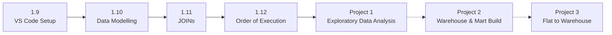

<a id="top"></a>

<p align="center">
  
</p>

<p align="center">
  
  
  
  
  
</p>

<p align="center">
  <a href="#-about">About</a> •
  <a href="#-learning-path">Learning Path</a> •
  <a href="#-lessons">Lessons</a> •
  <a href="#-projects">Projects</a> •
  <a href="#-skills-demonstrated">Skills</a> •
  <a href="#-how-to-run">How to Run</a>
</p>

---

## 👋 About

This repository is my **SQL data engineering portfolio**. It follows my progress from the fundamentals (exploring a data warehouse, joining tables, understanding how queries execute) to complete projects that answer real business questions with real-world job posting data.

| Folder | What's inside |
|---|---|
| 📚 [**Lessons/**](Lessons/) | Practice queries written while learning each core SQL concept |
| 🚀 [**Projects/**](Projects/) | End-to-end projects that apply those concepts to business questions |

All queries run on **DuckDB** against a job postings data warehouse hosted on **MotherDuck**.

---

## 🧭 Learning Path

Each lesson builds a skill that the projects rely on:



| Step | Topic | Skill gained | Used in Project 1 for... |
|---|---|---|---|
| [1.9](#19--vs-code-intro) | VS Code setup | Running SQL from an editor against DuckDB | Writing and running every query |
| [1.10](#110--data-modelling) | Data modelling | Understanding the star schema and its tables | Knowing which tables hold postings, skills and salaries |
| [1.11](#111--joins) | JOINs | Combining fact, bridge and dimension tables | Linking every job posting to its skills |
| [1.12](#112--order-of-execution) | Order of execution | How SQL processes a query, and reading query plans | Filtering with `WHERE` vs `HAVING`, and ordering by aliases |

<p align="right"><a href="#top">⬆ back to top</a></p>

---

## 📚 Lessons

### The data warehouse

Every lesson and project queries the same **star schema**: a central fact table of job postings, linked to dimension tables for companies and skills.

<p align="center">
  
</p>

| Table | Type | What it holds |
|---|---|---|
| `job_postings_fact` | Fact | One row per job posting: title, location, remote flag, country, salary |
| `company_dim` | Dimension | Company name, links and thumbnail |
| `skills_dim` | Dimension | Skills catalog with names and types |
| `skills_job_dim` | Bridge | Links each posting to the skills it requires (many-to-many) |

---

### 1.9 · VS Code Intro

📄 [`1.9_VScode_Intro.sql`](Lessons/1.9/1.9_VScode_Intro.sql)

**What's going on:** Setting up the development environment: VS Code as the SQL editor, connected to DuckDB and the MotherDuck warehouse. The first query lists every distinct country in the job postings, which confirms the connection works and gives a quick feel for the data.

**Concepts:** `SELECT DISTINCT` · running queries from an editor

---

### 1.10 · Data Modelling

📄 [`1.10_Data_Modelling.sql`](Lessons/1.10/1.10_Data_Modelling.sql)

**What's going on:** Exploring the warehouse before analysing it. The script works through five steps:

| # | Step | Purpose |
|---|---|---|
| 1 | Preview `job_postings_fact` | Look at sample job IDs, titles, salaries and company IDs |
| 2 | Preview `company_dim` | See the reference data that joins to postings on `company_id` |
| 3 | Query `information_schema.columns` | List every table's columns and data types |
| 4 | `PRAGMA show_tables_expanded` | Show all tables with expanded metadata |
| 5 | `DESCRIBE job_postings_fact` | Check column names, types and nullability |

**Concepts:** star schema · fact vs dimension tables · primary and foreign keys · `information_schema` · `DESCRIBE`

---

### 1.11 · JOINs

📄 [`1.11_JOINS.sql`](Lessons/1.11/1.11_JOINS.sql)

**What's going on:** Comparing join types by combining job postings with company and skills data:

| Join | Tables | What it returns |
|---|---|---|
| `LEFT JOIN` | postings → companies | Every posting, with company details where available |
| `RIGHT JOIN` | postings → companies | Every company, including companies with no postings |
| `FULL OUTER JOIN` | postings ↔ companies | Every row from both sides, matched where possible |
| `LEFT JOIN` ×2 | postings → bridge → skills | Every posting with its skills, including postings with no skills listed |
| `INNER JOIN` ×2 | postings → bridge → skills | Only postings that have at least one skill |

**Key lesson:** use `LEFT JOIN` to keep every job posting, even ones without a skill listed. `INNER JOIN` is right when only matched records matter, as in the Project 1 skill analysis.

**Concepts:** `LEFT` / `RIGHT` / `FULL OUTER` / `INNER JOIN` · multi-table joins through a bridge table · table aliases

---

### 1.12 · Order of Execution

📄 [`1.12_Order_Execution.sql`](Lessons/1.12/1.12_Order_Execution.sql)

**What's going on:** Running `EXPLAIN ANALYZE` on a query that finds the top 10 companies with more than 3,000 US job postings, to see how DuckDB actually executes it. SQL is written in one order but processed in another:


**Why it matters:**
- `WHERE` filters rows **before** grouping, while `HAVING` filters groups **after** aggregation.
- `ORDER BY` runs after `SELECT`, which is why it can use column aliases like `job_postings_count`.
- `EXPLAIN ANALYZE` shows the query plan and the time spent in each step, the starting point for query optimisation.

**Concepts:** logical order of execution · `WHERE` vs `HAVING` · `EXPLAIN ANALYZE` · query plans

<p align="right"><a href="#top">⬆ back to top</a></p>

---

## 🚀 Projects

### 🔍 Project 1: Exploratory Data Analysis ✅

📂 [`Projects/1_EDA/`](Projects/1_EDA/) · 📖 [Full write-up](Projects/1_EDA/README.md)

<a href="Projects/1_EDA/"></a>

**What's going on:** Applying the lessons to one business question: *which skills should a data engineer learn to be the most employable and best paid?* Three queries each answer one part of it, moving from the data warehouse (left), through SQL analytics (middle), to insights (right).

| Query | Question | Headline finding |
|---|---|---|
| 📈 [`01_top_demanded_skills.sql`](Projects/1_EDA/01_top_demanded_skills.sql) | Which skills are most in demand? (remote US) | **SQL (8,665)** and **Python (8,118)** lead, followed by AWS and Azure |
| 💰 [`02_top_paying_skills.sql`](Projects/1_EDA/02_top_paying_skills.sql) | Which skills pay the most? (US) | Pay is tightly clustered at **$137.5K-$157.5K**; Kafka and Airflow balance pay and demand best |
| ⚖️ [`03_optimal_skills.sql`](Projects/1_EDA/03_optimal_skills.sql) | Which skills balance demand and salary? (remote US) | **Terraform** scores highest; Python, AWS, SQL, Airflow, Spark and Snowflake form the core stack |

**Lessons applied:** star schema navigation (1.10) · multi-table `INNER JOIN`s through the bridge table (1.11) · `WHERE` vs `HAVING` and aliases in `ORDER BY` (1.12)

**New techniques:** `MEDIAN()` for robust salary statistics · `LN()` log-weighted scoring · DuckDB `BAR()` charts

---

### 🏗️ Project 2: Data Warehouse & Mart Build 🚧

**What it will cover:** a production-style ETL pipeline that loads raw CSV files, models them into a star schema warehouse, and builds data marts for analytics.

---

### 🔄 Project 3: Flat to Warehouse Build 🚧

**What it will cover:** transforming flat job posting data into a normalised star schema.

<p align="right"><a href="#top">⬆ back to top</a></p>

---

## 💻 Skills Demonstrated

| Area | Skills | Where |
|---|---|---|
| **Data exploration** | `information_schema`, `DESCRIBE`, `PRAGMA`, `SELECT DISTINCT` | [1.9](Lessons/1.9/1.9_VScode_Intro.sql) · [1.10](Lessons/1.10/1.10_Data_Modelling.sql) |
| **Data modelling** | Star schema: fact, dimension and bridge tables, primary and foreign keys | [1.10](Lessons/1.10/1.10_Data_Modelling.sql) · [Project 1](Projects/1_EDA/) |
| **Joins** | `INNER`, `LEFT`, `RIGHT`, `FULL OUTER`, multi-table joins | [1.11](Lessons/1.11/1.11_JOINS.sql) · [Project 1](Projects/1_EDA/) |
| **Aggregation** | `COUNT()`, `MEDIAN()`, `ROUND()`, `GROUP BY`, `HAVING` | [1.12](Lessons/1.12/1.12_Order_Execution.sql) · [Project 1](Projects/1_EDA/) |
| **Query performance** | Order of execution, `EXPLAIN ANALYZE` | [1.12](Lessons/1.12/1.12_Order_Execution.sql) |
| **Analytical metrics** | Log transformation with `LN()`, custom scoring | [03](Projects/1_EDA/03_optimal_skills.sql) |
| **Tooling** | DuckDB CLI, MotherDuck, VS Code, Git/GitHub | All |

---

## 📂 Repository Structure

```
SQL_Data_Engineering_Projects/
├── Lessons/
│   ├── 1.9/1.9_VScode_Intro.sql          # Environment setup, first query
│   ├── 1.10/1.10_Data_Modelling.sql      # Exploring the star schema
│   ├── 1.11/1.11_JOINS.sql               # Join types compared
│   └── 1.12/1.12_Order_Execution.sql     # Order of execution, EXPLAIN ANALYZE
├── Projects/
│   ├── 1_EDA/                            # ✅ Project 1: Exploratory Data Analysis
│   │   ├── 01_top_demanded_skills.sql
│   │   ├── 02_top_paying_skills.sql
│   │   ├── 03_optimal_skills.sql
│   │   └── README.md
│   └── Images/                           # Diagrams and banners
└── README.md                             # You are here
```

---

## 🚀 How to Run

The data lives in a shared **MotherDuck** database (`data_jobs`).

### Option 1: Cloud (MotherDuck, no install)

1. Sign up for a free [MotherDuck](https://motherduck.com/) account.
2. Open **MotherDuck Studio** in your browser.
3. Attach the database, then paste in any query from this repo:

```sql
ATTACH 'md:_share/data_jobs/87603155-cdc7-4c80-85ad-3a6b0d760d93';
```

### Option 2: Local (DuckDB CLI)

1. Install the DuckDB CLI using the [MotherDuck install guide](https://motherduck.com/docs/getting-started/interfaces/connect-query-from-duckdb-cli/).
2. Launch DuckDB and connect to the database:

```sql
ATTACH 'md:_share/data_jobs/87603155-cdc7-4c80-85ad-3a6b0d760d93';
USE data_jobs;
```

3. Or run a whole script from your terminal:

```bash
duckdb "md:data_jobs" < Projects/1_EDA/03_optimal_skills.sql
```

---

## 🙌 Acknowledgements

These lessons and projects were built while following the free [**SQL for Data Engineering**](https://youtu.be/UjhFbq4uU2Y) course by [Luke Barousse](https://www.linkedin.com/in/luke-b) ([course repo](https://github.com/ayodejid1/SQL_Data_Engineering_Course)). The job postings dataset was collected with [SerpApi](https://serpapi.com/).

---

<p align="center">
  <b>⭐ If you found this useful, consider giving the repo a star!</b><br>
  <a href="https://github.com/ayodejid1">@ayodejid1</a> • <a href="#top">⬆ Back to top</a>
</p>
